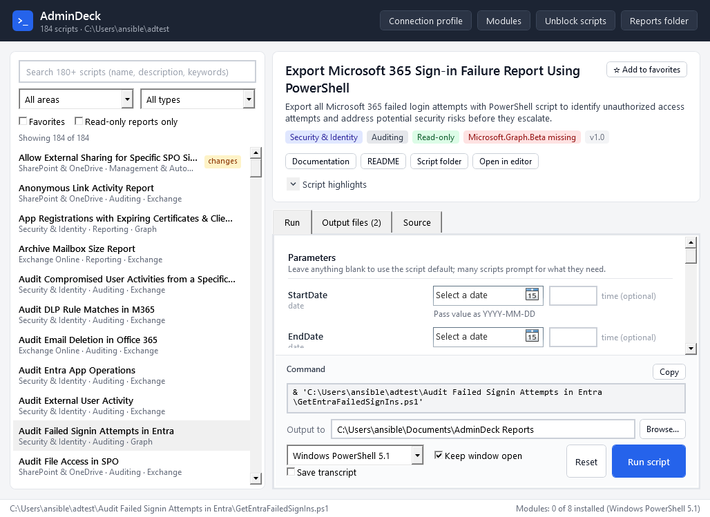

# AdminDeck

A Windows GUI for the 180+ PowerShell scripts in this repository. Pick a script, fill in a form, and it runs in its own console with the output collected in a per-script folder.



No install or build step is needed. It is plain PowerShell + WPF and runs on stock **Windows PowerShell 5.1** (Windows 10/11, Server 2016+).

## Start it

Double-click **`AdminDeck.cmd`** in the repo root, or run:

```powershell
powershell -NoProfile -ExecutionPolicy Bypass -STA -File .\AdminDeck\AdminDeck.ps1
```

To add a Start Menu shortcut, run:

```powershell
powershell -NoProfile -ExecutionPolicy Bypass -File .\AdminDeck\AdminDeck.ps1 -CreateShortcut
```

If you downloaded the repo as a ZIP, click **Unblock scripts** once. It removes the "downloaded from the internet" mark from the `.ps1` files.

## What it does

- **Browse and search**: every script, with its area (Exchange Online, Entra, SharePoint & OneDrive, Teams, Security & Identity) and type (Reporting, Auditing, Management & Automation), taken from `ScriptMetadata.csv`. Search covers names, descriptions, keywords and the script highlights. You can star favorites.
- **Safety flag**: scripts that may change the tenant get a *changes* badge, and you confirm before they run. The flag comes from Management & Automation scripts plus any `Set-/Remove-/New-/Add-...` call on M365 objects outside comments and strings. Use **Read-only reports only** to hide them.
- **Generated forms**: each script's `param()` block is read with the PowerShell parser, so the form always matches the script:
  | Parameter | Control |
  |---|---|
  | `[switch]` | checkbox |
  | `[ValidateSet(...)]` | dropdown |
  | `[datetime]` | date picker + optional time |
  | `[int]` / `[decimal]` | number box (validated) |
  | `[string[]]` / `[array]` | multi-line, comma or newline separated |
  | `*Password*` / `*Secret*` | masked box |
  | `*Csv` / `*File` / `*Path` | text + Browse |

  Inline comments such as `#Pass value as YYYY-MM-DD` show up as hints. Mandatory fields are marked, and parameter sets are explained.
- **Sign-in section**: `TenantId`, `ClientId`, `CertificateThumbprint`, `Organization`, `UserName` and similar fields are grouped separately. Leave them blank for interactive MFA sign-in, or save them once in **Connection profile** for certificate-based (unattended) auth, and they pre-fill every script.
- **Run**: the script starts in a new Windows PowerShell 5.1 or PowerShell 7 console, so its own prompts (module install, sign-in) work normally. Its current folder is `Documents\AdminDeck Reports\<script>\`, which is where its CSVs land. Options: keep the window open, save a transcript. Scripts that use PnP.PowerShell default to PowerShell 7 when it is installed.
- **Output files**: lists what the script wrote (including scripts that write next to themselves) and refreshes every couple of seconds. **View in grid** opens a CSV in a sortable, filterable table.
- **Modules**: shows which of Microsoft.Graph, Microsoft.Graph.Beta, ExchangeOnlineManagement, PnP.PowerShell, MicrosoftTeams, etc. are installed, and installs any of them for the current user.
- **Remembers**: your last values per script, favorites, profile and options, stored in `%APPDATA%\AdminDeck\settings.json`. Every run is logged to `history.log` there, with secrets masked.

## Secrets

Passwords and client secrets are never saved, never shown in the command preview, and never put on a command line. They reach the child console through a process-scoped environment variable, which the console copies into a local variable and deletes before the script starts. The **Copy** button copies the masked command.

## Files

| File | Purpose |
|---|---|
| `AdminDeck.cmd` (repo root) | double-click launcher, no console window |
| `AdminDeck/AdminDeck.ps1` | the WPF app |
| `AdminDeck/AdminDeck.Catalog.psm1` | script discovery, metadata, parameter parsing, command building (no UI), shared by both apps |
| `AdminDeck/Export-AdCatalog.ps1` | writes the whole catalog with parameters as JSON (used by the macOS app) |
| `AdminDeck/macOS/` | native SwiftUI app for macOS that runs scripts in pwsh via Terminal; see its [README](macOS/README.md) |
| `AdminDeck/Tests/Catalog.Tests.ps1` | headless tests: parses every script, round-trips the generated commands, and launches a dummy script end-to-end |

Run the tests:

```powershell
powershell -NoProfile -ExecutionPolicy Bypass -File .\AdminDeck\Tests\Catalog.Tests.ps1
```

`AdminDeck.ps1 -RenderTo shot.png [-RenderSelect 'Audit Failed*'] [-RenderTab Run|Outputs|Source] [-RenderSearch text]` renders the window off-screen to a PNG. It is for checking the UI on a machine you can only reach over SSH.

## Notes

- The scripts themselves are unchanged from upstream ([admindroid-community/powershell-scripts](https://github.com/admindroid-community/powershell-scripts)). AdminDeck only reads them, so pulling upstream updates just works.
- Module status is what *this* PowerShell sees. Windows PowerShell 5.1 and PowerShell 7 have separate module folders for CurrentUser installs.
- MSOnline and AzureAD are retired by Microsoft. Scripts that still use them may no longer work against your tenant.
