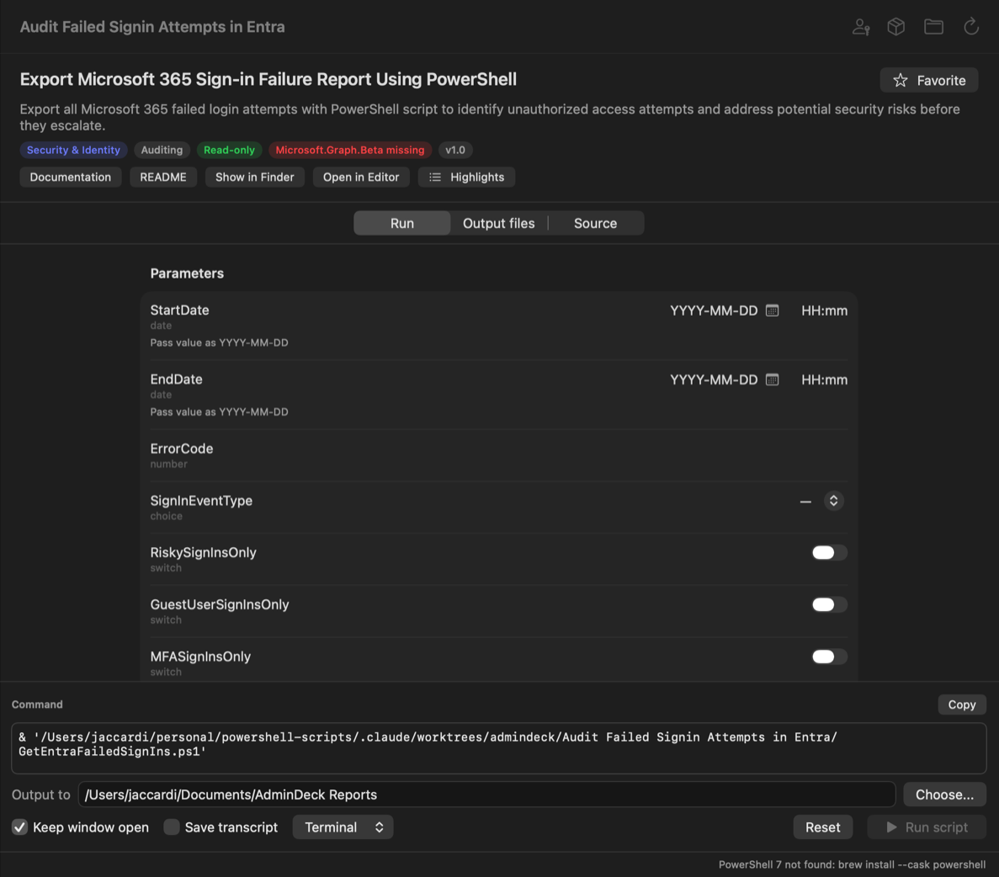

# AdminDeck for macOS

A native SwiftUI version of [AdminDeck](../README.md) for the scripts in this repo. Scripts run in **PowerShell 7 (pwsh)** in Terminal.



## Requirements

- macOS 14.4 or later. The binary is universal: Apple Silicon and Intel.
- PowerShell 7: `brew install powershell`. If pwsh is missing, the app offers to run this for you in Terminal.
- Modules for the scripts you use, e.g. `Microsoft.Graph`, `ExchangeOnlineManagement`. The **Modules** button shows which are installed and installs any of them.

## Build

There is no Xcode project, the same as the other single-file Mac apps:

```bash
./build.sh            # builds build/AdminDeck.app
./build.sh --install  # also copies it to /Applications and launches it
```

`build.sh` bundles `../AdminDeck.Catalog.psm1` and `../Export-AdCatalog.ps1`, plus the path of this repo, which becomes the default scripts folder. You can choose another folder in Settings, or download a fresh clone from the first-run screen.

## How it works

- **Catalog**: on launch, the app runs `Export-AdCatalog.ps1` in pwsh. That uses the same PowerShell-AST parser as the Windows app, so both understand scripts identically, and writes every script's metadata and parameters as JSON. The result is cached in `~/Library/Application Support/AdminDeck/`, so later launches show the list instantly while it refreshes. Use **Reload** after `git pull`.
- **Forms**: the same mapping as on Windows. Switches become toggles, ValidateSet a dropdown, dates a text field + calendar + optional time, numbers are validated, lists take commas or new lines, secrets use a SecureField, and file/folder params get Choose... buttons. Sign-in fields are grouped and pre-filled from **Connection profile** (TenantId / ClientId / CertificateThumbprint for cert auth; the certificate must be in your keychain).
- **Badges**: *changes* means the script may modify the tenant, and you confirm before it runs. *Windows* means it uses something that doesn't exist on macOS (MSOnline/AzureAD/SPO modules, COM automation, WinForms, WMI). Those 13 scripts will probably fail here; use the Windows app for them. The **Mac-friendly** filter hides them.
- **Running**: the app writes a `launch.ps1` and a `run.command` into a private (0700) folder under `~/Library/Caches/AdminDeck/runs/` and opens it in Terminal (or iTerm). The script's current folder is `~/Documents/AdminDeck Reports/<script>/`, which is where its CSVs land. The scripts' own prompts and browser sign-in work normally.
- **Secrets**: they never appear on a command line or in the preview, history or transcript. They go into a 0600 `secrets.json` in that run folder, and `launch.ps1` reads them and deletes the whole run folder before the script starts.
- **Output files**: lists what the script wrote and refreshes every 2 s. CSVs open in a built-in sortable, filterable table.

Settings, favorites and last-used values (never secrets) live in `~/Library/Application Support/AdminDeck/settings.json`. Runs are logged with secrets masked in `history.log` there.

## Known limits

- Most scripts end with a Windows-only "open the output file?" popup (`wscript.shell`). On macOS that last step prints an error, but the report has already been written. Open it from **Output files**.
- Some scripts build paths with `\`. pwsh on macOS usually copes, but a few may write oddly named files. Check **Output files**.

## Testing hooks

```bash
APP=build/AdminDeck.app/Contents/MacOS/AdminDeck
# Render the window to a PNG without showing anything else (catalog from a JSON fixture, no pwsh needed):
$APP --catalog-json catalog.json --render-to shot.png --select 'Audit Failed*' --tab run|output|source
ADMINDECK_DUMP=1 $APP ...      # also prints the real AppKit controls with their frames (layout checks)
# Write launch.ps1/secrets.json/run.command for a dummy script with awkward values:
$APP --write-launch /tmp/run --script /path/Dummy.ps1 --outdir /tmp/out --pwsh /opt/homebrew/bin/pwsh
```

Generate a fixture with `pwsh -File ../Export-AdCatalog.ps1 -RepoRoot ../.. -OutFile catalog.json`.
